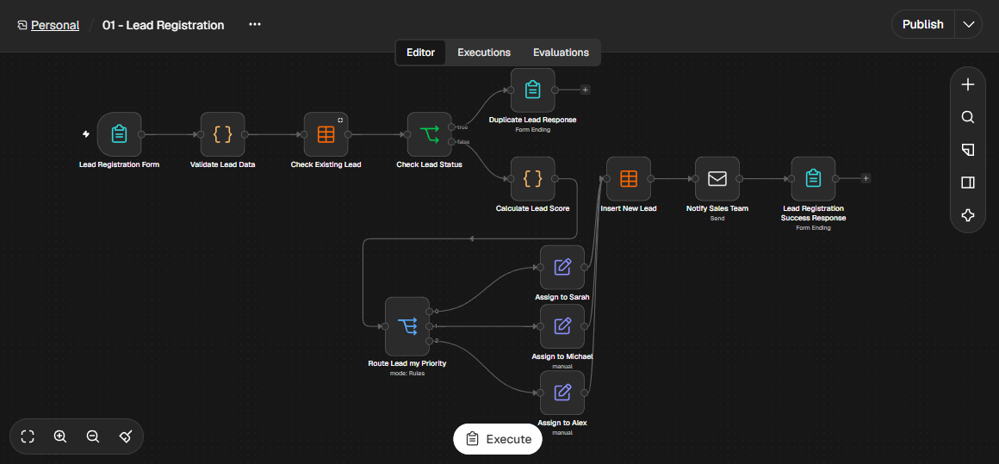
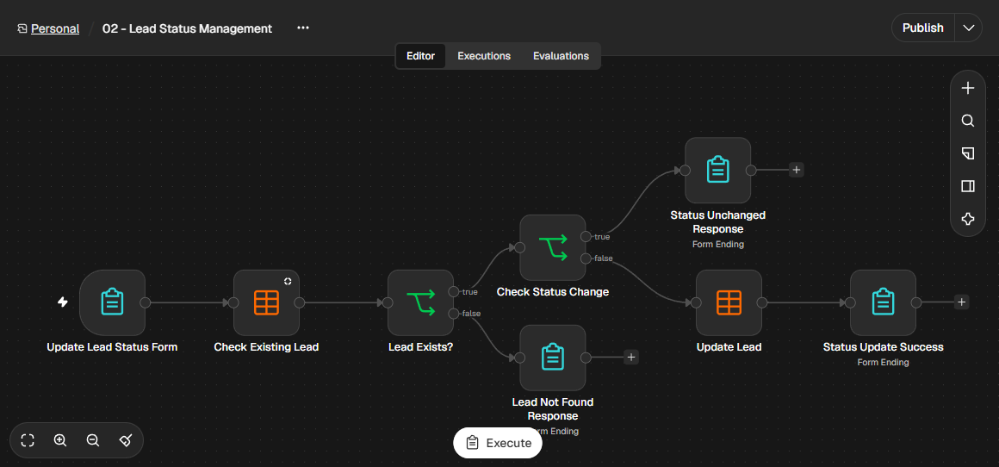
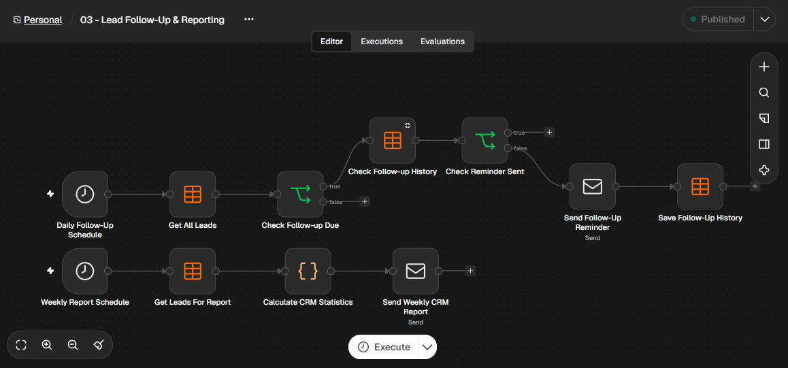
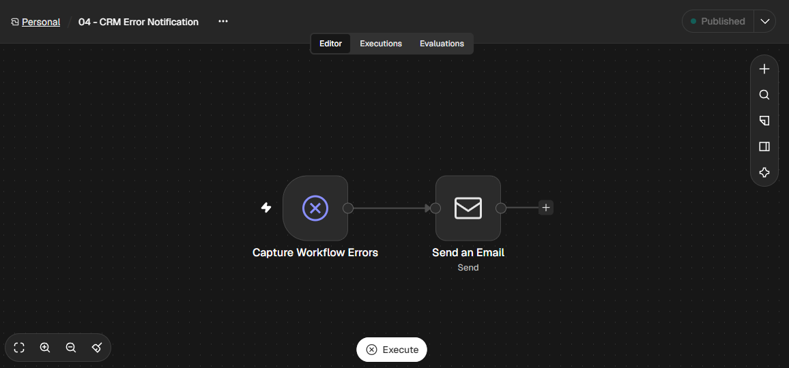
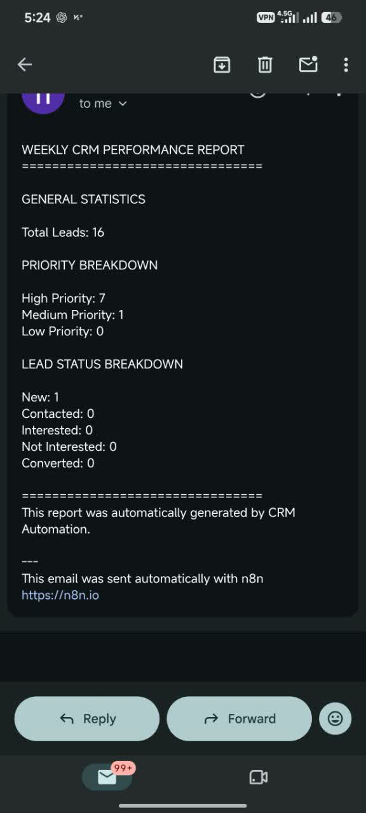

CRM Automation System

An automated Customer Relationship Management (CRM) system built with n8n to manage leads, track customer interactions, automate follow-ups, generate reports, and monitor workflow errors.

Project Overview

This project demonstrates how business processes can be automated using workflow automation, conditional logic, data management, and email notifications.

The system consists of four independent but complementary workflows that cover the main stages of lead management.

System Architecture

The CRM system contains four main workflows:

Lead Registration – Collects, validates, scores, and assigns new leads.

Lead Status Management – Updates and tracks lead statuses.

Lead Follow-up & Reporting – Automates follow-up reminders and generates weekly reports.

CRM Error Notifications – Captures workflow errors and sends notification emails.

Workflows

1. Lead Registration

Automates the process of registering new leads.

Main features:

Collects lead information through a form.

Validates required fields and input data.

Checks for duplicate email addresses before registration.

Calculates a lead score based on submitted information.

Assigns a priority level to each lead.

Assigns leads to the appropriate team member.

Saves new leads in the CRM Data Table.

Sends email notifications after successful registration.

Lead scoring criteria:

FieldScoreFull Name10Email20Phone20Company30Source20 

Priority levels:

High: 70–100

Medium: 40–69

Low: Below 40

2. Lead Status Management

Allows users to update the status of existing leads.

Main features:

Searches for leads using their email address.

Checks whether the lead exists.

Compares the current status with the requested status.

Prevents unnecessary updates when the status has not changed.

Updates the CRM Data Table when a new status is selected.

Returns appropriate responses for successful updates or missing leads.

Available statuses:

New

Contacted

Interested

Not Interested

Converted

3. Lead Follow-up & Reporting

Automates customer follow-ups and generates periodic CRM reports.

Daily follow-up automation:

Runs automatically every day at 9:00 AM.

Identifies leads with a valid follow-up date.

Checks whether the follow-up date is due.

Searches FollowUp History to prevent duplicate reminders on the same day.

Sends reminder emails.

Records completed follow-up notifications.

Weekly reporting automation:

Runs every Monday at 9:00 AM.

Retrieves lead records.

Calculates total leads.

Summarizes leads by priority.

Summarizes leads by status.

Sends a weekly CRM report through email.

4. CRM Error Notifications

Provides centralized error monitoring for the CRM workflows.

Main features:

Captures workflow execution errors.

Identifies the workflow where the error occurred.

Collects execution information.

Includes the last executed node and error message.

Provides the execution URL for troubleshooting.

Sends an automatic error notification email.

Data Management

The project uses n8n Data Tables to store and manage CRM information.

Leads Table

Stores lead information, including:

Full Name

Email

Phone

Company

Source

Score

Priority

AssignedTo

Status

FollowUpDate

FollowUp History Table

FollowUp History Table

Stores records of sent follow-up reminders to prevent duplicate notifications.

Fields:

- "leadEmail" – Identifies the lead.
- "reminderDate" – Stores the reminder date.
- "sentAt" – Records when the reminder email was sent.

The workflow checks this table before sending a reminder to avoid sending multiple notifications for the same lead on the same date.

Stores follow-up notification records to prevent duplicate reminders.

The history records are used to determine whether a reminder has already been sent for a specific lead on a particular date.

Duplicate email addresses are detected before registration to prevent duplicate lead records.

## Workflow Screenshots

### 1. Lead Registration

### 2. Lead Status Management

### 3. Lead Follow-up & Reporting

### 4. CRM Error Notifications

### 5. Weekly CRM Report

Technologies Used

n8n – Workflow automation

JavaScript – Data validation, calculations, and business logic

n8n Data Tables – Data storage and management

SMTP / Email – Automated notifications and reporting

GitHub – Version control and project documentation

Project Structure

crm-automation-system/ │ ├── workflows/ │ ├── 01-lead-registration.json │ ├── 02-lead-status-management.json │ ├── 03-lead-follow-up-reporting.json │ └── 04-error-notifications.json │ ├── screenshots/ │ ├── 01-lead-registration.png │ ├── 02-lead-status-management.png │ ├── 03-lead-follow-up-reporting.png │ ├── 04-error-notifications.png │ └──weekly-crm-report.png │ └── README.md 

Setup & Usage

Import the workflow JSON files into your n8n instance.

Configure the required Data Tables.

Set up your email credentials and SMTP configuration.

Review form fields, email recipients, and workflow settings.

Configure the error workflow for the main CRM workflows.

Activate the workflows that use scheduled triggers.

Test each workflow with sample lead data.

Note: Email credentials, Data Tables, and other environment-specific settings must be configured in your own n8n instance.

Key Concepts Demonstrated

Workflow automation and orchestration

Conditional branching using IF and Switch nodes

Data validation and duplicate detection

JavaScript-based business logic

Automated lead scoring and assignment

Scheduled tasks and reporting

Data persistence and history tracking

Centralized error handling

Email-based business notifications

Project Purpose

The goal of this project was to build a practical CRM automation system that reduces repetitive manual tasks, improves lead management, and provides better visibility into customer follow-up activities.

Author: Hoseinitu
